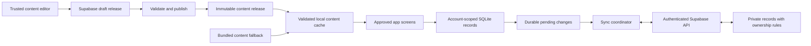

# Implementation Plan: BuildWisp Supabase Migration

## Overview

Add optional accounts and cloud synchronization for saved work, then make learning content editable through versioned Supabase releases. Keep a local database and bundled lessons so learning and editing continue without internet. Deliver this in separately verified phases; this document authorizes planning only and does not create a Supabase project or change runtime behavior.

Prepared with ECC Planner on 27 November 2026. Repository: `D:/App-Dev_Handbook`; paths below are relative to that root. Proposed files are explicitly marked **new**. Update, 28 November: Phase 1 contracts/fixtures and automated verification are implemented; see [migration evidence](supabase-migration-evidence.md). Installed-device baseline remains a gate before Phase 3 storage cutover. Phases 2–8 are not implemented.

## Requirements & Scope

- Optional email/password account, email verification/recovery, sign out, and account deletion; guests can continue learning locally. This is a proposed default, not a user-selected authentication method.
- Synchronize projects, Plan Mode drafts, build proof, milestone notes, readiness reviews, setup checkpoints, quiz/review history, daily practice, and flashcard scheduling.
- Preserve existing saved records when upgrading or signing in. Never upload guest work into an account without showing the destination and obtaining consent.
- Continue offline, persist pending uploads across restarts, recover from timeouts, and expose actual sync state.
- Keep accounts isolated on the server and on shared devices. A response for an old account/session must never update the active account.
- Publish lessons, questions, practice tasks, glossary, prompts, help articles, build cards, and readiness checklists as validated content releases without an app-store release for compatible content changes.
- Keep all current screen behavior, first-success XP, evidence validation, and first daily-answer behavior. Cloud sync is not supplied automatically by adding the Supabase client.
- Preserve manual backup/restore and its explicit replacement confirmation. A local restore must not silently replace cloud data.
- Prototype new account, import, conflict, and sync surfaces for user approval before implementation, following the existing screen-by-screen process.
- Explicit non-goals: custom admin website, social login in the first increment, team projects, collaborative editing, leaderboards, payments, cloud backup file hosting, push notifications, and background sync guarantees while Android has terminated the app.
- App layout, recommendation/scoring algorithms, validation, and secrets stay in code/server configuration. They are not remote lesson content.

### Proposed defaults and prerequisites

- Start with email/password and guest mode; Google sign-in can be a later approved increment.
- Use Supabase Dashboard for trusted administrators to edit draft content. Validate and publish with a controlled script; changing a draft must not change learners' current content.
- Use separate development and production Supabase projects. Production region, organization ownership, email delivery, data retention, spending limits, and intended audience are deployment decisions still to be recorded.
- No credentials are needed to review this plan. Hosted verification later needs a development project URL and publishable key; privileged credentials belong only in a trusted local/server environment and must not be pasted into chat.
- Existing Android visual, TalkBack, file-sharing, and restore checks remain open. Cloud migration does not replace them. Capture a real-device local-data baseline before enabling a new storage adapter on user data.

## Architecture & Surface Changes

### What exists today

| Surface | Observed implementation | Migration implication |
|---|---|---|
| App | `android-app/package.json`: Expo 58, React Native 0.88, Expo Router, Expo SQLite | Reuse the installed SQLite dependency; add only required Auth/client dependencies after compatibility verification |
| Progress | `android-app/src/progress/provider.tsx`, `android-app/src/progress/store.ts`; key `academy.progress` | Current provider constructs one global store; it must reload safely when account scope changes |
| Projects | `android-app/src/projects/local.ts`, `android-app/src/projects/store.ts`; key `academy.projects` | Plans, proof, and milestones are nested inside projects; local IDs increment from 1 and collide across phones |
| Readiness | `android-app/src/projects/readiness.ts`; keys `academy.readiness.<projectId>` | Reviews are scoped to project and build; remapping project identity must preserve these links |
| Study | `android-app/src/study/local.ts`, `android-app/src/study/store.ts`; key `academy.study` | Daily answers preserve the first local record for each day; grades affect due dates |
| Backups | `android-app/src/backup/local.ts`, `android-app/src/backup/service.ts`, `android-app/app/backup.tsx` | Version 1 validates all records and writes a batch; restore also empties obsolete readiness keys |
| Content | `android-app/scripts/import-curriculum.mjs` generates four JSON files from `guide/` sources | Startup/typecheck/export regenerate content; this pipeline needs an explicit published-content cutover |
| References | Quiz IDs include positions, readiness IDs use check indexes, glossary IDs use term text, checked proof stores text | Reordering or renaming content can detach saved progress unless identifiers/aliases are preserved |

### Target data flow

### Proposed server model

Use structured ownership/revision columns and validated JSON payloads that mirror existing domain records. Avoid rewriting every field into a separate table for this first release.

| Table | Identity and purpose | Access |
|---|---|---|
| `user_workspaces` | `user_id`, server workspace revision; serialize mutations/restore against this row | Owner only |
| `learning_state` | One row per user; existing Progress payload plus server revision | Owner only |
| `study_state` | One row per user; existing daily/card payload plus server revision | Owner only |
| `projects` | Globally unique UUID, `user_id`, brief/plan/build/milestones payload, revision, tombstone | Owner only |
| `release_reviews` | UUID, `user_id`, owning project UUID, build, items, revision, tombstone; unique project/build | Owner only; composite ownership FK prevents references to another user's project |
| `sync_receipts` | Owner + operation UUID, request digest, committed result; deduplicate retries | Owner reads via controlled RPC; no direct client writes |
| `guest_imports` | Owner + guest dataset UUID, result mapping and import receipt | Owner only through import RPC |
| `content_releases` | Release UUID/version, format version, minimum reader version, draft/published state, checksum | Public reads of published compatible releases; administrator writes only |
| `content_documents` | Release + document kind: missions/articles/glossary/readiness, JSON payload | Published release reads only; no learner writes |
| `content_channels` | `stable` pointer to a published release | Public read; trusted publisher alone changes pointer |

Server constraints mirror client record limits and reject malformed nesting, unknown status values, empty required evidence, and unsupported payload versions. Enforce per-record/request/account size bounds; establish measured budgets during schema work rather than accepting unlimited JSON. Existing backup maximum remains 8 MB.

Expose owner reads through RLS. Writes use narrowly scoped RPCs that validate identity, payload, expected revision, and operation ID. Revoke direct write access that could bypass revision checks. Prefer invoker functions; where elevated functions are necessary, lock the search path, explicitly check `auth.uid()`, restrict execute grants, and test foreign-owner requests. Never trust a client-provided `user_id` alone.

### Local data and identity contract

- **New** `android-app/src/storage/database.ts`: SQLite transaction adapter, local record namespaces, metadata, pending operations, ID mappings, and conflict copies. Preserve current synchronous domain store APIs where feasible.
- **New** `android-app/src/storage/migrate.ts`: validate and copy existing SQLite KV records into a guest namespace in one transaction, then mark migration complete. Keep the original records as a recovery snapshot; do not delete them on upgrade.
- **New** `android-app/src/storage/scope.ts`: namespaces `guest:<dataset-uuid>` and `user:<auth-uuid>`. Guest dataset ID is durable across restarts; remote imports are keyed by it.
- Keep numeric local project IDs and existing routes for this increment. A durable mapping `(namespace, local_project_id) -> cloud_project_uuid` prevents collisions. Downloaded projects receive available local numeric IDs; readiness references are translated through that mapping. Never deduplicate by project name or by the numeric ID alone.
- Every local user mutation and its upload intent must commit together in SQLite. If either write fails, neither is reported saved. Do not write data first and append an upload later.
- Store pending operations by owner, entity, operation UUID, expected server revision, and payload snapshot. Applying a remote result does not enqueue that result again.
- Tokens use a dedicated, supported session storage adapter, separate from lesson/user backup records. Verify Expo SecureStore compatibility/large-session handling during implementation; never serialize Auth tokens into a backup.
- Pending uploads survive a restart. Signing out pauses the old account's queue and hides its cache; pending data is not silently deleted. Another account cannot see or upload that work. Provide an explicit remove-local-copy action only after warning about unsynced work.

### Synchronization contract

1. Local saves succeed without internet. Show **Saved on this device**, **Waiting to sync**, **Syncing**, **Synced**, **Sign in again**, or **Needs review**, based on actual state.
2. Sync on authenticated startup, foreground return, successful local saves, and explicit retry. Use bounded retries/backoff and a finite timeout; permission/validation failures require action rather than endless retries.
3. RPC commits lock the workspace, compare expected record revisions, validate content references, and persist the mutation and idempotency receipt together. A retry of an accepted operation returns the same result, including after an ambiguous timeout.
4. Acknowledging one upload cannot clear later edits to the same entity. Rebase subsequent queued work on the acknowledged revision. Resolve upload responses only for their original account/session generation.
5. Download a consistent owner snapshot for the initial bounded-data implementation; enforce payload budgets and measure bandwidth. Do not introduce Realtime subscriptions or an additional sync service initially. Add paginated/versioned download if measured dataset limits require it before release.
6. Apply downloaded data and its revision/mapping metadata in one local transaction; refresh active providers/screens without overwriting unsaved form drafts.
7. If two devices edit the same record from the same revision, reject the stale write as a conflict. Preserve both versions and pause that record. Do not use phone clocks or silently replace one whole project/progress record with the latest response.
8. First release conflict handling is conservative: show local/cloud differences and consequences, let the user keep a selected version after confirmation, and retry against the latest server revision. Unrelated records continue syncing. Keep a recoverable copy of the discarded version. Do not claim automatic merging of progress or flashcard schedules.
9. Display the current content release with conflict/import details. XP remains derived from accepted quiz records, not an independently incremented cloud counter. Personal learning sync is not a tamper-resistant leaderboard.

### Content publication contract

- Seed Supabase with exactly the current four generated documents: 13 missions, 16 lesson modules, 55 build cards, 17 readiness sections and 133 checks. Verify glossary/articles against actual generated fixtures rather than inventing counts.
- Preserve current IDs on initial import. Published documents carry explicit immutable IDs, never IDs recomputed from display order. Editing an assessed question's options/answer requires a new question ID/version or an explicit reviewed migration; positional `pick` values cannot silently change meaning.
- Initially reject changed/removed IDs, changed stored proof strings, or renamed glossary identities when saved records depend on them unless an alias/migration is included. Retirement keeps old references readable. Preserve scheduling/history across safe wording updates.
- Validate all four documents together, cross-references, official-link protocols, answer indexes, optional skip rules, and limits. Never evaluate downloaded JavaScript or execute prompt text.
- Draft -> validation -> immutable published release -> atomic `stable` pointer. Pin one release for an active learning session, download all documents, verify and cache them together, and adopt on a safe boundary. Do not mix versions during a quiz or reorder today's question mid-answer.
- Ship a tracked, known-good content snapshot. Missing internet, malformed data, unsupported format, interrupted downloads, or unavailable Supabase use the last valid cache, then the bundle.
- Keep the existing guide sources as initial seed/reference. After cutover, ordinary startup/typecheck/bundle must use a pinned published export and must not overwrite it with newly regenerated guide content. Updating the bundled fallback is a separate reviewed content export.
- Changing scoring, proof semantics, optional-card IDs, or rendering capabilities still requires compatible app code; not every change can be delivered as content.

## Implementation Steps

### Phase 1: Contracts, fixtures, and recovery baseline

Status: automated baseline/fixture and contract work complete; installed-device baseline pending. ECC Planner checkpoints and TDD proof are recorded in `android-app/docs/supabase-migration-evidence.md`.

1. **Freeze baseline and verify migration fixtures** (Files: `android-app/tests/backup.test.mjs`, `android-app/tests/projects.test.mjs`, `android-app/tests/readiness.test.mjs`, **new** `android-app/tests/fixtures/legacy-workspace.json`, **new** `android-app/docs/supabase-migration-evidence.md`)
   - Action: Confirm actual test filenames, capture representative valid version-1 records using synthetic data, including all nested project fields, two projects, cleared notes, multiple builds, quiz review dates, first daily answers and card schedules. Record current test/typecheck/bundle results and an installed-device backup/reopen baseline before storage cutover.
   - Why: Prove migration preserves every existing feature, not just a project count.
   - Dependencies: None. Real-device baseline is a cutover gate, not a reason to prevent schema planning.
   - Risk: Medium.

2. **Specify local/cloud DTOs and content identities** (Files: **new** `android-app/src/sync/contracts.ts`, **new** `android-app/src/content/schema.ts`, **new** `android-app/tests/content-compatibility.test.mjs`)
   - Action: Define payload versions, UUID mapping, revision/conflict responses, tombstones, import receipts, content release metadata, quotas, and upgrade rules. Write failing contract tests before implementing validators. Reuse or extract pure validators from existing stores without coupling tests to native modules.
   - Why: Prevent cross-device ID collisions and detached learning history.
   - Dependencies: Step 1 fixtures.
   - Risk: High.

### Phase 2: Supabase schema and access rules

3. **Add reproducible backend foundation** (Files: **new** `supabase/config.toml`, **new** `supabase/migrations/202611270001_workspace.sql`, **new** `supabase/migrations/202611270002_content.sql`, **new** `supabase/tests/database/ownership.test.sql`, **new** `supabase/tests/database/sync.test.sql`)
   - Action: Initialize a local development project, implement the tables above, grants/RLS, indexes, revision and idempotent write RPCs, and transactional import/replace operations. Test users A/B and signed-out access before exposing data. Generate client database types after schema passes.
   - Why: A publishable app key must never grant access to someone else's work or content publishing.
   - Dependencies: Step 2. Hosted setup needs an identified development project; local SQL/test work can proceed first.
   - Risk: High.

4. **Configure client and session lifecycle** (Files: **new** `android-app/src/cloud/client.ts`, **new** `android-app/src/auth/session-storage.ts`, **new** `android-app/src/auth/provider.tsx`, **new** `android-app/.env.example`, `android-app/package.json`, `android-app/package-lock.json`, `android-app/app.json`)
   - Action: Add the verified compatible Supabase client and session dependencies. Document `EXPO_PUBLIC_SUPABASE_URL` and `EXPO_PUBLIC_SUPABASE_PUBLISHABLE_KEY`. Retain the existing `buildquestacademy` scheme unless explicitly changed; configure verified confirmation/recovery callbacks. Add foreground session handling and stale-response cancellation. With no configuration, guest mode still launches.
   - Why: Add accounts without breaking existing offline installs or leaking credentials.
   - Dependencies: Step 3 for hosted data tests; UI deferred to approved prototypes.
   - Risk: High.

### Phase 3: Account-scoped local persistence

5. **Migrate local records transactionally** (Files: **new** `android-app/src/storage/database.ts`, **new** `android-app/src/storage/migrate.ts`, **new** `android-app/src/storage/scope.ts`, **new** `android-app/tests/storage-migration.test.mjs`)
   - Action: Implement the guest/user namespaces, validated one-time legacy copy, UUID maps, durable queue, and transaction failure handling. Simulate interruption before/after commit; repeated startup must not duplicate projects or replace a completed migration. Corrupt legacy data remains recoverable and blocks only its migration.
   - Why: Local data and future upload intent must survive crashes together.
   - Dependencies: Steps 1-2; identity contract from Step 4.
   - Risk: High.

6. **Reconnect existing stores and screen refreshes** (Files: `android-app/src/projects/local.ts`, `android-app/src/study/local.ts`, `android-app/src/progress/provider.tsx`, `android-app/src/backup/local.ts`, `android-app/app/_layout.tsx`, project/study/readiness route components)
   - Action: Route existing factories through the scoped adapter, retain domain validations, and add a scope generation/reset boundary for providers and forms. Mount data screens only after the scope is ready. Verify remote reload and account switching do not leave stale project names, evidence, or form drafts from another account.
   - Why: Existing modules instantiate global stores and some screens load once on mount.
   - Dependencies: Steps 4-5.
   - Risk: High.

### Phase 4: Cloud sync and existing-data import

7. **Implement durable sync and conflict behavior** (Files: **new** `android-app/src/sync/engine.ts`, **new** `android-app/src/sync/remote.ts`, **new** `android-app/src/sync/provider.tsx`, **new** `android-app/tests/sync.test.mjs`, **new** `android-app/tests/sync-conflicts.test.mjs`)
   - Action: Implement the synchronization contract above, including save/queue atomicity, consistent download, conditional writes, tombstones, account cancellation, receipt retry, and local conflict copies. Test both operation orders for two devices and restart with pending operations.
   - Why: Adding network writes directly to screen handlers would lose offline changes and hide conflicts.
   - Dependencies: Steps 3-6.
   - Risk: High.

8. **Import guest data once into the selected account** (Files: **new** `android-app/src/sync/import-guest.ts`, **new** `android-app/tests/guest-import.test.mjs`, import RPC in `supabase/migrations/202611270001_workspace.sql`)
   - Action: Preview source/destination counts, import only after consent, translate project IDs, use guest-dataset receipts, and preserve the source copy until a verified acknowledgement. Freeze/capture a consistent import snapshot; later edits must be queued, not missed. Existing cloud projects remain separate; overlapping progress/study records follow conflict review instead of blind overwrite.
   - Why: First sign-in must neither duplicate a device's projects on retry nor erase an existing account.
   - Dependencies: Step 7; approved import UI from Phase 7 before exposing this flow.
   - Risk: High.

### Phase 5: Cloud-aware backup and restore

9. **Preserve version-1 backups and define restore boundaries** (Files: `android-app/src/backup/service.ts`, `android-app/src/backup/local.ts`, `android-app/app/backup.tsx`, `android-app/tests/backup.test.mjs`, **new** `android-app/tests/restore-sync.test.mjs`)
   - Action: Continue reading version 1; introduce a validated version 2 only for necessary identity/content metadata. Export only the active namespace, never sessions or queues. Import v1 projects with fresh cloud UUIDs; preserve validated v2 lineage only within the same account and reject/detach foreign ownership metadata. Show **Replace data on this device** for signed-in local restores, pause outbound sync, cancel old queued work atomically, and save a recovery snapshot. Do not resume uploading the restored dataset until the user chooses either re-download cloud data or explicitly replace the cloud workspace.
   - Why: Existing Replace and restore wording only covers the device; ordinary sync could otherwise undo the restore or erase cloud data unexpectedly.
   - Dependencies: Steps 5-8 and approved revised backup wording.
   - Risk: High.

10. **Make explicit cloud replacement atomic** (Files: restore RPC in **new** `supabase/migrations/202611270003_restore.sql`, `android-app/src/sync/engine.ts`, **new** `supabase/tests/database/restore.test.sql`)
   - Action: Require a separate online preview/confirmation of account-wide replacement. Compare the full workspace revision, replace the user's dataset in one server transaction, record a receipt, and retain tombstones/generation so stale devices cannot resurrect removed data. If another device writes before commit, abort and request a refreshed preview. Offline restores remain local and paused until this choice is possible.
   - Why: Several independent upserts cannot implement safe whole-workspace replacement.
   - Dependencies: Step 9.
   - Risk: High.

### Phase 6: Remote learning content

11. **Seed, validate, and publish immutable content** (Files: `android-app/scripts/import-curriculum.mjs`, **new** `android-app/scripts/publish-content.mjs`, **new** `android-app/scripts/export-content.mjs`, **new** `android-app/content/bundled/release.json`, **new** `android-app/tests/content-release.test.mjs`)
   - Action: Bootstrap current documents, freeze IDs, validate the complete draft and compatibility manifest, publish through a trusted transaction, and export a pinned fallback. Publishing credentials remain outside the app. Document editing drafts in Dashboard and rolling the stable pointer back to a compatible release.
   - Why: Content updates should be reviewable and recoverable without serving partial course changes.
   - Dependencies: Steps 2-3; backup content-version handling in Step 9 before remote content rollout.
   - Risk: High.

12. **Replace direct JSON imports with one content provider** (Files: **new** `android-app/src/content/repository.ts`, **new** `android-app/src/content/provider.tsx`, `android-app/app/_layout.tsx`, `android-app/app/index.tsx`, `android-app/app/missions.tsx`, `android-app/app/getting-started.tsx`, `android-app/app/mission/[id].tsx`, `android-app/app/practice/[id].tsx`, `android-app/app/quiz/[id].tsx`, `android-app/app/result/[id].tsx`, `android-app/app/review.tsx`, `android-app/app/study.tsx`, `android-app/app/build/[id].tsx`, `android-app/app/milestones/[id].tsx`, `android-app/app/readiness/[id].tsx`, `android-app/app/help.tsx`, `android-app/src/library/search.ts`)
   - Action: Inventory all generated imports again, serve one consistent release, rebuild search indexes when it changes, and derive counts from that release. Preserve safe startup fallback and pin active sessions/daily selections. Inspect hard-coded setup prompts and planning metadata separately: move explanatory copy only when the schema supports it; keep algorithms/option validation in code.
   - Why: Moving JSON to Supabase alone does not update screens that still import bundled arrays.
   - Dependencies: Steps 7, 9, 11.
   - Risk: High.

### Phase 7: Approved account and synchronization screens

13. **Prototype, approve, and implement the new flows** (Files: **new** `android-app/app/account.tsx`, **new** `android-app/app/auth-callback.tsx`, **new** `android-app/app/sync-review.tsx`, **new** `android-app/src/components/SyncStatus.tsx`, `android-app/app/index.tsx`, `android-app/app/_layout.tsx`, `android-app/app/backup.tsx`)
   - Action: Show prototypes for sign-in/sign-up/recovery, guest import summary, account/sync state, conflict review, revised restore choices, sign-out with pending work, and account deletion. Implement each after approval. Keep the approved clay palette, accessible labels and 48dp targets. Use supported email callbacks, finite loading/error states, and no false cloud-save claim.
   - Why: Accounts and cloud replacement add user decisions absent from the existing designs.
   - Dependencies: Prototype work can start after Step 2; integration requires Steps 4-10. Content status requires Step 12.
   - Risk: Medium for presentation; High for account lifecycle and cloud replacement.

14. **Complete account lifecycle and trusted administration** (Files: **new** `supabase/functions/delete-account/index.ts`, `android-app/app/account.tsx`, **new** `android-app/docs/supabase-operations.md`)
   - Action: Implement a server-authorized account deletion route with ownership checks, confirmation/re-authentication as supported, cascade cleanup, and immediate cancellation of local sync. Privileged deletion credentials stay server-side. Document private-cache removal/retention, support recovery, email configuration, administrator access, and redacted logs. Do not make guest fallback display the deleted account's work.
   - Why: Optional sign-up needs a complete and safe account lifecycle.
   - Dependencies: Steps 3-7, approved account prototype.
   - Risk: High.

### Phase 8: Staged rollout and handoff

15. **Verify on development infrastructure and two Android devices** (Files: **new** `android-app/docs/supabase-migration-evidence.md`, `android-app/README.md`, `android-app/TODO.md`)
   - Action: Run the verification matrix below, rehearse migration and rollback with synthetic data, and record build/device/release IDs. Enable guest-only storage migration first, then Auth/import/sync for testers, then remote content; each rollout gate must pass before enabling the next.
   - Why: Storage, identity, and content must not all change without an observable recovery path.
   - Dependencies: All relevant phases; user-owned hosted development project and installed Android builds.
   - Risk: High.

## Testing & Verification Strategy

### Automated tests

- Retain all current 50 domain tests as the baseline, then add focused failing tests for each new behavior before implementing it. Do not count current tests as proof of future Auth, sync, native UI, or RLS behavior.
- Legacy migration: complete records, missing/corrupt values, interrupted transactions, repeated upgrade, storage-full failures, numeric-ID collisions, and readiness remapping.
- Auth/scope: unconfigured guest mode, invalid/expired callback, verification/recovery, offline session, refresh failure, sign out/account switch during a request, and no cross-user cache or queued writes.
- Sync: local write + queue rollback, timeout after server commit, duplicate retry, two devices editing one/different records, older acknowledgement arriving after a newer edit, stale downloads, failed validation, and restart with pending changes.
- Imports: empty and populated cloud account, duplicate import, crash before acknowledgement, canceled import, guest edits during import, and same local project ID from two guest datasets.
- Preserve first-success XP, quiz/review timestamps, first daily answer, local calendar-day behavior, and scheduling when conflicts are resolved. A conflict choice must explain changed totals rather than award duplicate XP.
- Restore: v1 and v2 validation, foreign lineage, wrong content versions, canceled confirmation, old queue cancellation, local-only paused state, complete cloud replacement, concurrent writes, stale device reappearance, and transactional rollback.
- RLS/SQL: owner access succeeds; guest/another user cannot read/write private records, forge ownership, bypass revision gates, or invoke publishing/deletion for others. Draft content is unreadable to learners; published content is read-only. Test functions with real authenticated client roles as well as pgTAP.
- Content: seed parity, unique stable IDs, valid cross-references, removed/renamed IDs, reordered answer choices, changed proof text, malformed/oversized documents, unsupported reader version, partial download, cache corruption, session pinning, and publication rollback.

### Validation commands and evidence

- Existing app checks, from `D:/App-Dev_Handbook/android-app`: `npm test`, `npm run typecheck`, `npm run check:bundle`.
- `git diff --check` from the repository root.
- Add explicit package scripts for new contract/integration tests only after the actual runner and environment are established. Keep native SDK imports outside Node-only domain tests.
- From the repository root with a verified local Supabase CLI/runtime: `supabase start`, local-only `supabase db reset`, `supabase test db`. Never reset a hosted database or select a production target for a test command.
- Generate database types from the verified development schema; check them into the client and verify typecheck. Do not invent a passing CLI result or require a specific unverified CLI version in the plan.
- Record RED/GREEN results for new logic and the exact fixture/migration/release used. Coverage should focus on changed branches; a percentage is not evidence of successful device flows.

### Manual proofs

1. Existing offline install -> update -> guest records identical -> export/reopen unchanged; repeat migration after an interrupted launch.
2. Phone A: create an account, verify email, consent to importing old work. Phone B: sign in and verify exact project evidence/progress after download.
3. On A in airplane mode, edit a project and answer practice; close/reopen. Reconnect and sync; B receives the accepted records once.
4. Edit the same project on A/B before syncing. Verify the conflict is visible, both versions survive, and a confirmed choice converges. Also verify edits to different projects sync independently.
5. Switch accounts with a request in flight and with pending changes. Neither account sees the other's projects; old work is recoverable only after returning to its account.
6. Restore a test backup offline: only local data changes and sync pauses. Cancel cloud replacement: cloud stays unchanged. Confirm online replacement: both phones converge without stale records reappearing.
7. Edit a draft lesson in Dashboard: learners see no change. Publish: a compatible app adopts the complete release at a safe boundary. Airplane mode still opens lessons. Roll back the pointer and verify safe adoption without erasing history.
8. Verify Android email callbacks, back navigation, keyboard, large text, TalkBack, reduced motion, landscape, export sharing, local file picker, restore cancellation and failures. Use synthetic accounts and backups.
9. Delete a test account; verify server authorization, removal of owned records, canceled queues, and no re-upload after restarting either phone.

### Rollback

- Roll out local migration, cloud sync, and remote content under independent runtime configuration. A local recovery option must disable sync even if Supabase is unavailable.
- Disable outbound sync first; retain pending operations and conflict copies. Continue reading the current scoped local data. Turning sync off is not an instruction to revert to stale legacy KV records.
- Keep migrations additive initially. Do not drop legacy records, old payload support, stable content IDs, or old server columns during the rollout window.
- Roll content back by selecting a known-good compatible release; the last valid cache/bundle remains available during outages.
- After new scoped writes exist, installing an old binary is not a safe data rollback. Export current scoped data or use a forward repair; only restore the untouched legacy snapshot with an explicit explanation of changes made since it was captured.
- Capture a pre-import/pre-restore recovery snapshot, test restoring it, and restrict any hosted data repair to the intended account. Never reset production as a rollback shortcut.

## Risks & Mitigations

- **Risk:** Two phones create project 1 and overwrite each other.
  - Mitigation: Global cloud UUIDs, durable scoped mappings, and explicit identity translation in imports, downloads, and backups.
- **Risk:** A crash saves local work but loses its pending upload.
  - Mitigation: One SQLite transaction for data, metadata, mapping, and queue writes; test interruption boundaries.
- **Risk:** Concurrent offline changes erase notes or alter daily-answer history.
  - Mitigation: Revision checks, no clock-based overwrite, recoverable conflict versions, and confirmed resolution.
- **Risk:** A restore silently propagates destructive changes or old devices resurrect removed rows.
  - Mitigation: Pause sync for local restores; separate cloud replacement confirmation, transactional revision check, generations/tombstones.
- **Risk:** Account switching exposes another person's cached work.
  - Mitigation: Namespace isolation, generation checks on every response, provider/form reset, and owner-bound queues.
- **Risk:** New lessons change the meaning of existing quiz answers, flashcards, or proof.
  - Mitigation: Frozen identifiers, compatible content versions, retirement/aliases, assessed-question versioning, and session pinning.
- **Risk:** Public client configuration is mistaken for authorization.
  - Mitigation: Publishable key only in the app; RLS plus explicit grants and tested RPC authorization; elevated secrets stay trusted-side.
- **Risk:** Cloud availability/cost or large payloads harm the learning experience.
  - Mitigation: Local-first rendering, bounded requests/retries, measured payload limits and bandwidth, no Realtime dependency initially, staging monitoring and spending configuration before release.
- **Risk:** Changes are called complete after only bundling.
  - Mitigation: Separate domain/SQL evidence from installed two-device and accessibility proofs; leave rollout disabled until the relevant gates pass.

## Success Criteria

- [ ] A current offline install upgrades without losing any valid saved record; migration is repeatable after interruption.
- [ ] Guests can use all current local learning/project features with no Supabase configuration or internet.
- [ ] Sign-in, verification, recovery, sign-out, and deletion work on an installed Android build.
- [ ] Existing guest data imports only with consent and does not duplicate on retries or erase existing cloud records.
- [ ] Two devices show the same accepted records after sync; pending changes survive offline restarts.
- [ ] Numeric project collisions, readiness references, stale responses, and concurrent edits are handled without silent loss.
- [ ] Server and local isolation tests prove one account cannot read, write, or accidentally upload another account's work.
- [ ] Real sync state distinguishes local saves from acknowledged cloud saves.
- [ ] Version-1 backups still restore; local and cloud replacement boundaries are explicit and tested.
- [ ] Content can be edited as a draft and published without a new app build when compatible; IDs/history remain intact.
- [ ] Interrupted/invalid remote content never replaces a valid cache, and fresh installs can learn offline from the bundle.
- [ ] All new screens receive prototype approval before implementation.
- [ ] Current and new focused tests, SQL access tests, typecheck, Android export, two-device proofs, and accessibility checks pass.
- [ ] Recovery/rollback is rehearsed on development data; no production data or privileged keys are exposed in the app/repository.

Planning references checked 27 November 2026: [Supabase React Native Auth](https://supabase.com/docs/guides/auth/quickstarts/react-native), [API key roles](https://supabase.com/docs/guides/getting-started/api-keys), [Row Level Security](https://supabase.com/docs/guides/database/postgres/row-level-security), [mobile callbacks](https://supabase.com/docs/guides/auth/native-mobile-deep-linking), [database migrations](https://supabase.com/docs/guides/local-development/database-migrations), [database tests](https://supabase.com/docs/guides/database/testing), and [Expo SQLite](https://docs.expo.dev/versions/latest/sdk/sqlite/). These support platform choices; the sync, conflict, content, and restore contracts above are proposed BuildWisp application design.
